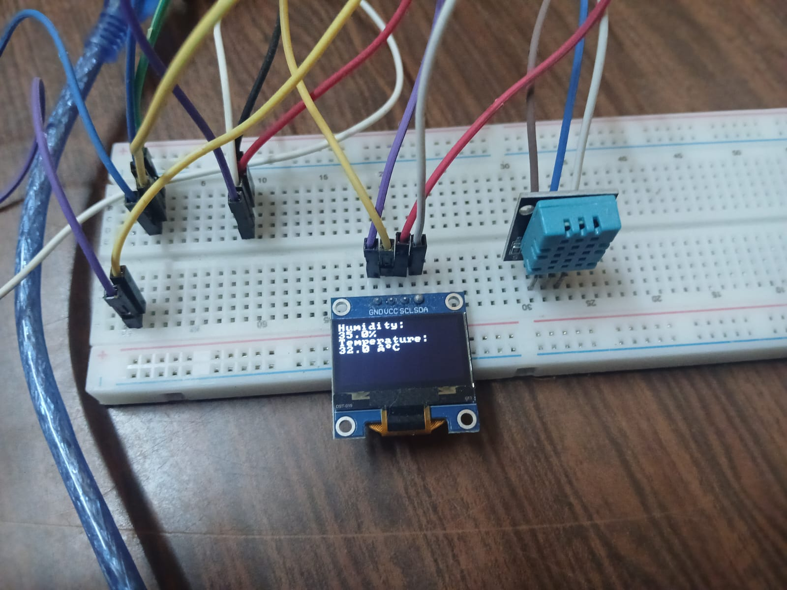
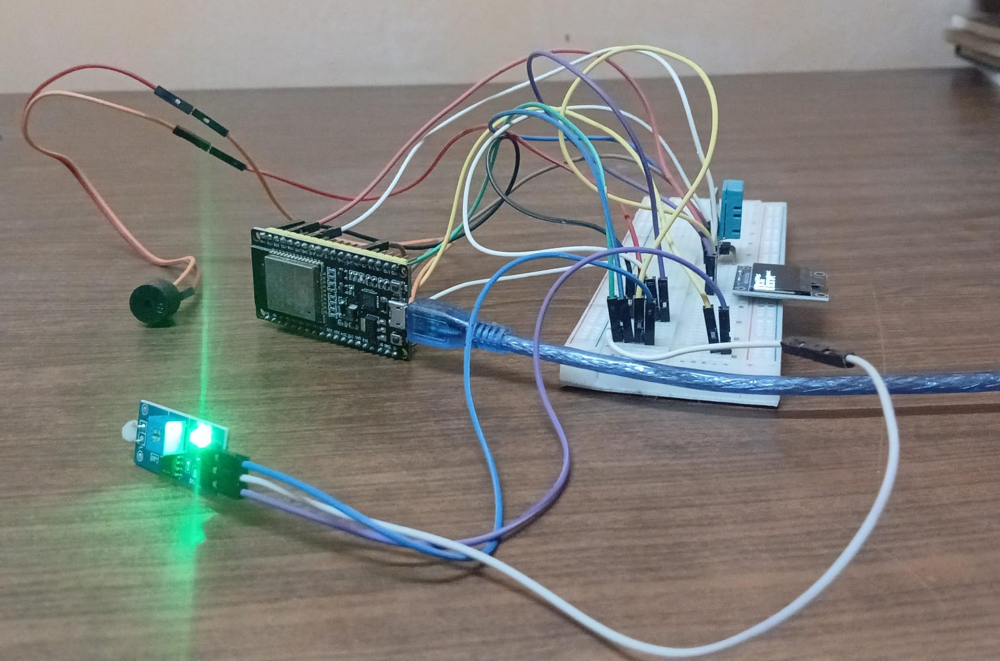

# SmartHub — ESP32 Environmental Monitoring System

## Overview

SmartHub is a personal embedded systems project built around an ESP32 microcontroller. It integrates environmental sensors and electronic components to monitor temperature, humidity, light, and motion.

## Features

- Temperature and humidity monitoring.
- Environmental light sensing.
- Motion detection with LED indicators.
- Display output for environmental readings.
- Experimental audible alerts using a buzzer.

## Hardware

- ESP32 development board.
- Temperature and humidity sensor.
- Light sensor.
- Motion sensor.
- Display module.
- LEDs.
- Buzzer.
- Breadboard and connecting wires

## Technologies

- Embedded C/C++ 
- ESP32.
- ESP-IDF

## Project Status

Personal project. Some features and improvements may still be in development.

## Project Photos

## Author

José Victorino Rizo Castillo

GitHub: https://github.com/AVictorino1